<!-- Replace every yuvraj1235 with your actual GitHub username -->

**Embedded ML & firmware engineer-in-the-making** · NIT Durgapur, India

*Making hardware smarter, one open-source commit at a time.*

[GitHub](https://github.com/yuvraj1235) · [Website](https://YOUR_PORTFOLIO_URL)

✦ ────────────────────── ✦

## Identity, with signal

| | **LIVE SIGNAL** |
|---|---|
| Hardware/software integration, embedded ML, firmware and open source.  **Focus:** `ESP-IDF` · `Embedded ML` · `Vision-Language Models`  B.Tech CSE at NIT Durgapur. Active in GLUG NIT Durgapur, the university's open-source club. |  |

✦ ────────────────────── ✦

## What moves the work

|  **01** | **02** | **03** |
|:--|:--|:--|
| **Firmware** | **Embedded ML** | **Open source** |
| ESP32-S3 smartwatch: ESP-IDF, LVGL, FreeRTOS, on-device sensor ML | LLaVA-style VLM from scratch, RAG pipelines | Excalidraw, GLUG NITD, community tooling |

Positioning is useful when the proof is close behind it.

✦ ────────────────────── ✦

## The tools behind the signal

  
  
  
  
  
  
  
  
  

chosen for the work, not the trend

✦ ────────────────────── ✦

## Built, shipped, shared

| [**esp32-smartwatch**](https://github.com/yuvraj1235/REPO) | [**llava-vlm**](https://github.com/yuvraj1235/REPO) | [**glug-rag-chatbot**](https://github.com/yuvraj1235/REPO) | [**excalidraw (multi-font)**](https://github.com/excalidraw/excalidraw) |
|:--|:--|:--|:--|
| AMOLED smartwatch firmware on ESP32-S3 with ESP-IDF, LVGL and FreeRTOS. | LLaVA-style vision-language model: frozen CLIP encoder + small LLM + projector. | RAG chatbot backend for GLUG NIT Durgapur, with scraper and deployment. | Contribution adding multi-font support for non-Latin scripts. |
| `C` · `ESP-IDF` | `Python` · `PyTorch` | `Python` · `RAG` | `TypeScript` |

✦ ────────────────────── ✦

## Momentum, made visible

✦ ────────────────────── ✦

## The trail behind the work

every day leaves a trace

✦ ────────────────────── ✦

## Make something worth noticing

*I like working with people who care about craft, context, and shipping the useful version.*

  
  
  

